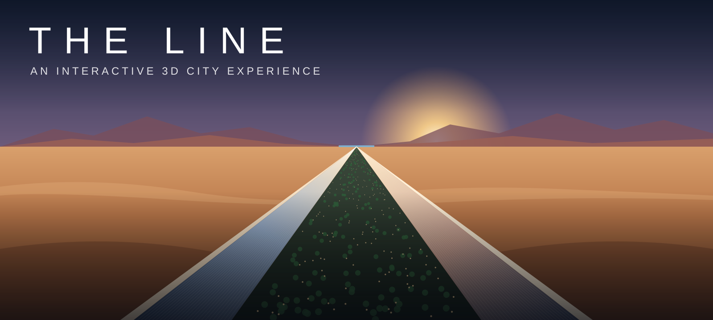

# THE LINE

**An interactive 3D city experience — explore the future of urban living in your browser.**

[**Explore the city →**](https://the-line.co)

---

## About

**The Line** is an interactive 3D visualization inspired by NEOM's linear-city concept in Saudi Arabia.

Instead of static renders and architectural drawings, it lets anyone walk, fly and look around the city: its architecture, landscapes, infrastructure and environments — straight from the browser.

> **Vision:** large-scale architectural ideas should be explorable by everyone. The project is meant to keep growing through collaboration, experimentation and community contributions.

## Features

| | Feature | Description |
|---|---|---|
| 🏙️ | **Interactive 3D environment** | Explore a large-scale futuristic city in real time |
| 🌊 | **Multiple environments** | Coast, Promenade, Canyon, Waterfall, Marina and Aerial views |
| 🚶 | **First-person exploration** | Walk through the city at street level |
| 🌅 | **Dynamic lighting** | Different lighting conditions and times of day |
| 🌿 | **Architectural exploration** | Residential areas, sky gardens, waterfronts and infrastructure |
| 🧭 | **Interactive navigation** | Move, zoom and switch perspectives freely |

## The concept in numbers

| Length | Height | Width | Platform | Status |
|:---:|:---:|:---:|:---:|:---:|
| **170 km** | **500 m** | **200 m** | Web browser | In development |

## Built with

- **Next.js** + **TypeScript** — web application
- **Three.js** / **React Three Fiber** — real-time 3D rendering
- **Blender** — 3D modelling and asset preparation
- **Payload CMS** — locations, zones, descriptions and images
- **Cloudflare R2** — storage for 3D models and media

## Roadmap

- [x] Interactive city visualization
- [x] Multiple exploration environments
- [x] Interactive camera controls
- [x] First-person city exploration
- [ ] Expand architectural environments
- [ ] More detailed city infrastructure
- [ ] 3D performance and optimization
- [ ] Expanded interactive exploration
- [ ] Community-driven development

## Contributing

Developers, 3D artists, architects and designers are all welcome. Areas where help is especially useful:

- 🧱 3D modelling and architectural visualization
- 🛤️ City infrastructure and environment design
- 🖱️ Interactive navigation and user interfaces
- ⚡ Performance optimization and web-based 3D rendering
- 💡 Lighting, materials and visual effects
- 🗺️ New interactive environments

**How to get involved**

1. Explore the project at [the-line.co](https://the-line.co).
2. Pick an area where you'd like to help.
3. [Open an issue](https://github.com/EricksonAtHome/THE-LINE/issues) with an idea, suggestion or bug report.
4. Fork the repo and submit a pull request.

## Disclaimer

The Line is an **independent** digital visualization project inspired by the NEOM urban development concept. It is **not** an official NEOM product and is not affiliated with, endorsed by or operated by NEOM or the Saudi Arabian government. All trademarks, names and referenced concepts remain the property of their respective owners.

## License

Released under the [MIT License](LICENSE) © 2026 Erickson Hyppolite Poel.

---

**Explore. Imagine. Build the future.**

[the-line.co](https://the-line.co)

